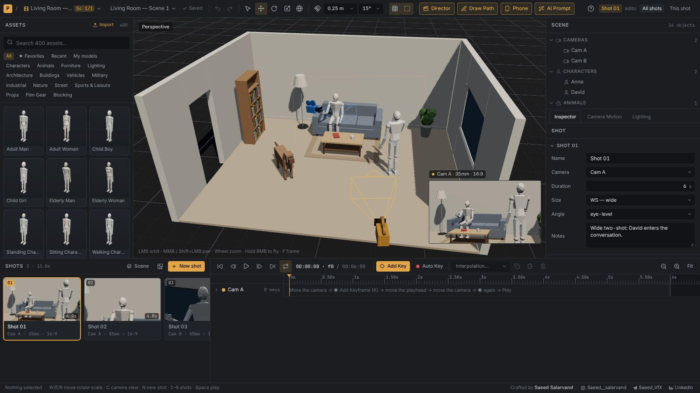
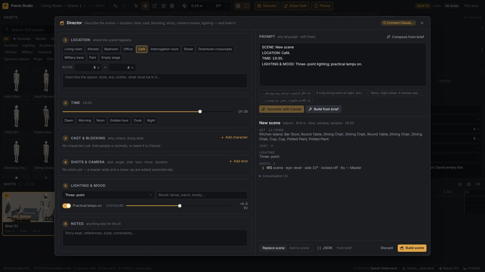
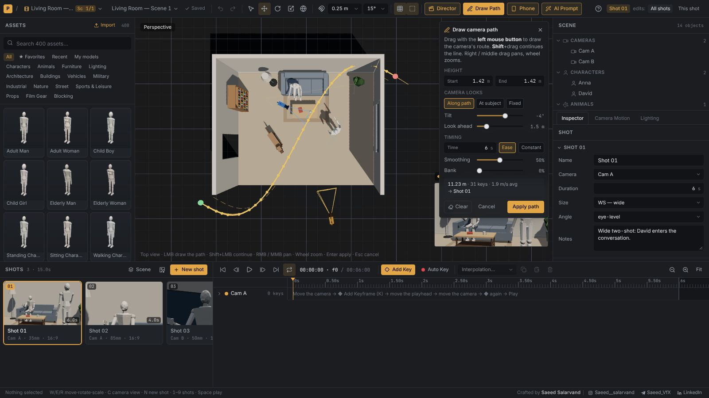
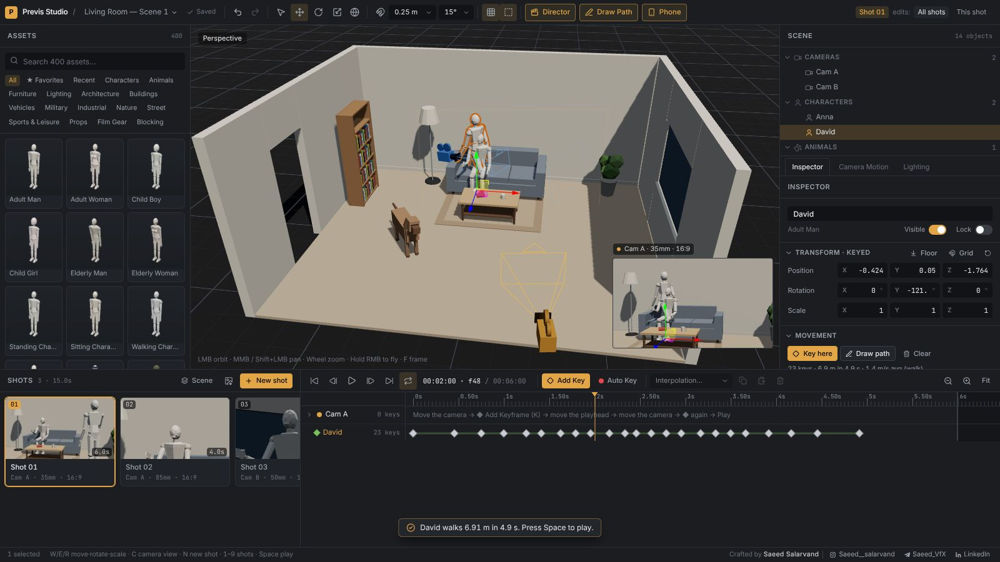
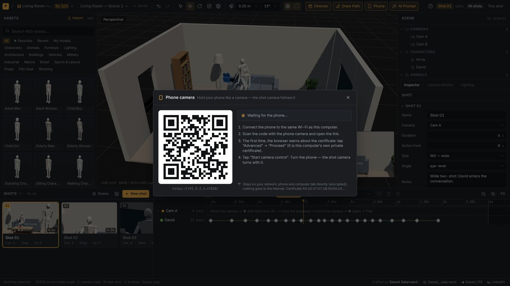
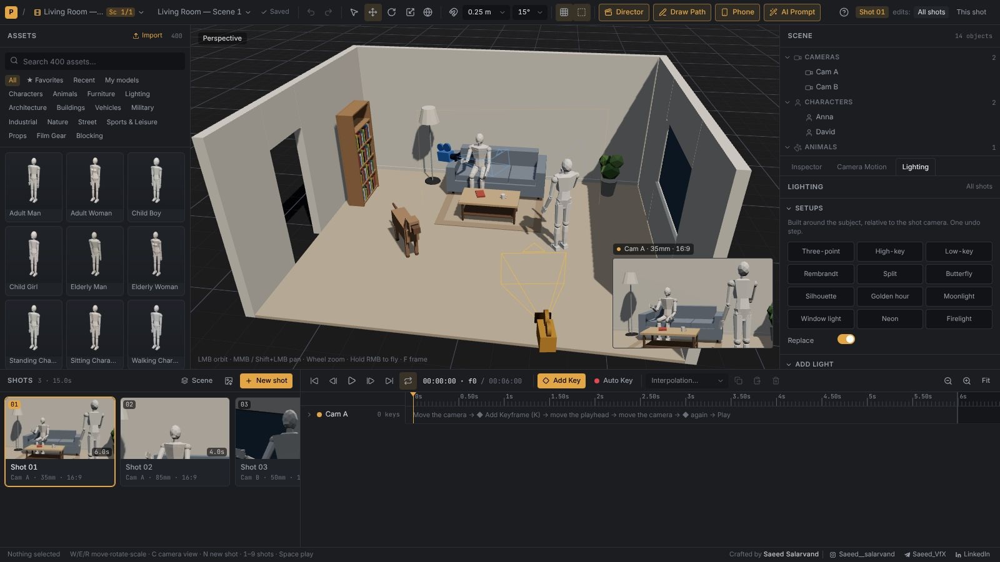
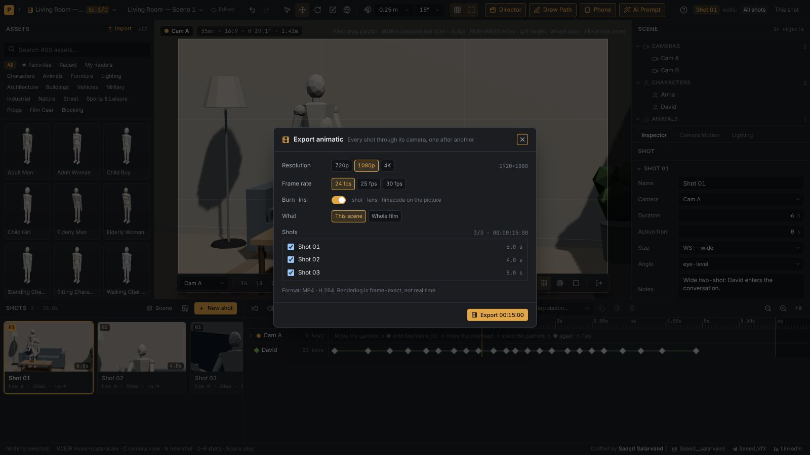

  

<h1 align="center">Previs Studio</h1>

<b>3D previs &amp; virtual directing for filmmakers</b> Build the set · block the actors · shoot coverage with real lenses · animate · light · steer the camera with your phone · export the animatic

  <a href="https://github.com/saeedsalarvand/previs-studio-app/releases/latest/download/Previs-Studio-Setup.exe"><b>⬇ Download for Windows</b></a>

Version 1.5.2 · Windows 10 / 11 · free · works fully offline

---

## What it does

| | |
|---|---|
| 🎬 **Shots &amp; real lenses** | Cameras with focal length, sensor, aspect ratio (2.39 … 9:16), focus and frame guides; a shot list with per-shot adjustments. |
| 🧱 **400 ready models** | Characters, animals, furniture, lamps and chandeliers, buildings and towers, vehicles, military, street kits, nature, props, film gear. |
| ✨ **AI Director** | Describe a scene in any language — set, blocking, shots, camera moves and lighting are built for you. Offline from a brief, or with Claude — your Claude chat (no API key) or your own API key. |
| 🎥 **Camera motion** | Dolly, crane, jib, orbit, arc, follow, handheld… plus timing, smoothing, tracking, rigs (steadicam, drone, car mount…) and shake. |
| ✏️ **Draw Path** | Draw the camera’s route — or an actor’s, or a car’s — from the top view; it becomes the animation. |
| 🚶 **Actors walk, cars drive** | Keyframe characters and vehicles: walk / jog / run by speed, no foot sliding, wheels that roll and steer. |
| 💡 **Lighting** | Three-point, Rembrandt, low-key, golden hour, moonlight… in one click; Kelvin, stops, practical lamps, time of day, exposure. |
| 📱 **Phone camera** | Scan a QR code and move your phone — the shot camera follows. Record handheld takes over your own Wi-Fi. |
| 📜 **Screenplay → Film** | Paste a script in any language: every scene is built — sets (shared when a place returns), cast with timed blocking, lighting and shots. |
| 🎬 **Film, scenes & sets** | A film of sequences and scenes, each scene with its own set, light and cast. Reusable sets (the same location in many scenes) with safe updates, and a film timeline to reorder, play and export the whole film. |
| 📦 **Your own models** | Import .glb, .gltf, .fbx and .obj — units detected, own materials or clay look, kept in My models and saved inside project files. |
| 🔊 **Sound** | Dialogue, music and effects tracks on the scene’s time — in sync across cuts, heard in playback, written into the animatic. |
| 🖼️ **Reference images** | A storyboard panel or reference frame over each shot’s camera frame to match it, and images as panels in the set. |
| 📋 **Storyboard PDF** | A panel per shot through its camera, with shot size, angle, lens, camera move, action and notes — one scene or the whole film. |
| 🪄 **AI prompt & frames** | First / last frames of every shot plus an English prompt written from the real scene (shot size, angle, lens, move, actors, light) for Seedance, Kling, Veo, Runway and others — copy it, or export a ZIP for the whole sequence. |
| 🎞️ **Animatic export** | Every shot through its camera into one MP4 with burn-ins (shot, lens, timecode), 720p to 4K. |

  
  
  
  
  
  

## Install

**Windows 10 / 11 (64-bit)** — download [`Previs-Studio-Setup.exe`](https://github.com/saeedsalarvand/previs-studio-app/releases/latest/download/Previs-Studio-Setup.exe) and run it. If SmartScreen says “Windows protected your PC”, click **More info → Run anyway** (the installer is not code-signed yet).

Updates install themselves: the app checks for a new version when it starts (**Help → Check for Updates…**).

## User manual

A complete, illustrated guide in English, فارسی and Español is built into the app (**?** button / **Help → User manual**) and works offline.

## Privacy

- No account, no tracking. Projects are saved on your computer.
- Phone control talks directly between your phone and your computer on your local network, encrypted.
- The AI Director sends your scene description to Anthropic only when you use it, with **your** API key, which stays on your computer — or not at all, when you copy the prompt into your own Claude chat.

## Creator

**Saeed Salarvand** — [Instagram](https://instagram.com/Saeed__salarvand) · [Telegram](https://t.me/Saeed_VfX) · [LinkedIn](https://www.linkedin.com/in/saeed-salarvand/)

© 2026 Saeed Salarvand. Free to use. The source code is private; this repository hosts the releases.
